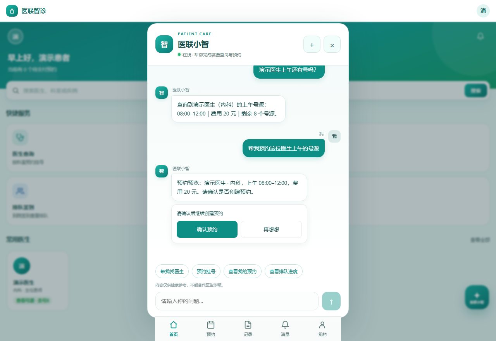
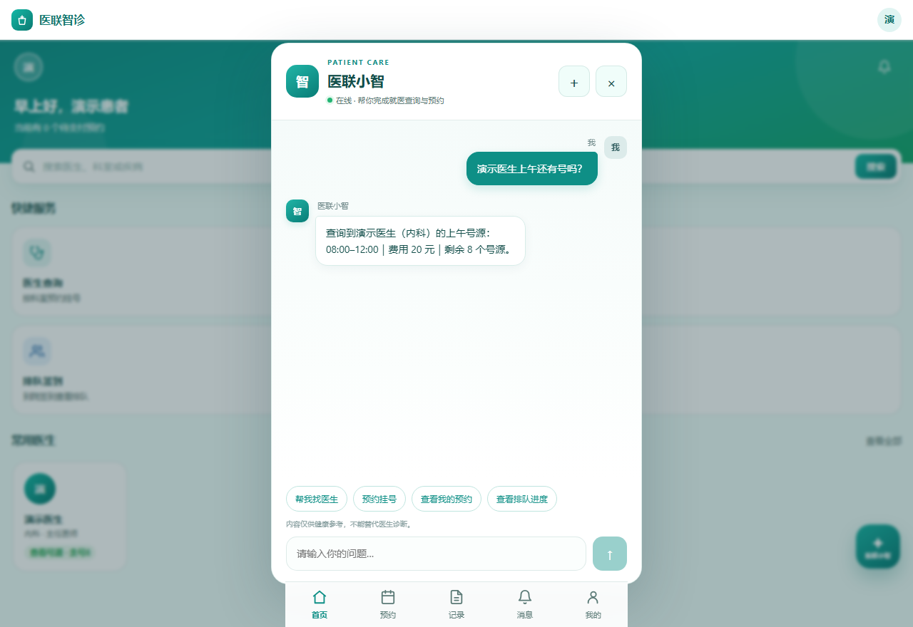
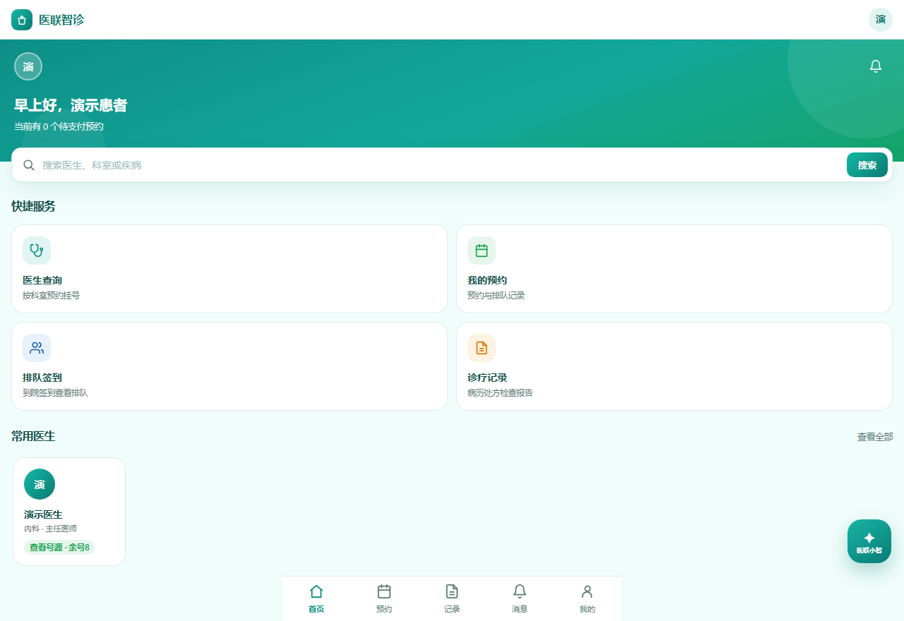
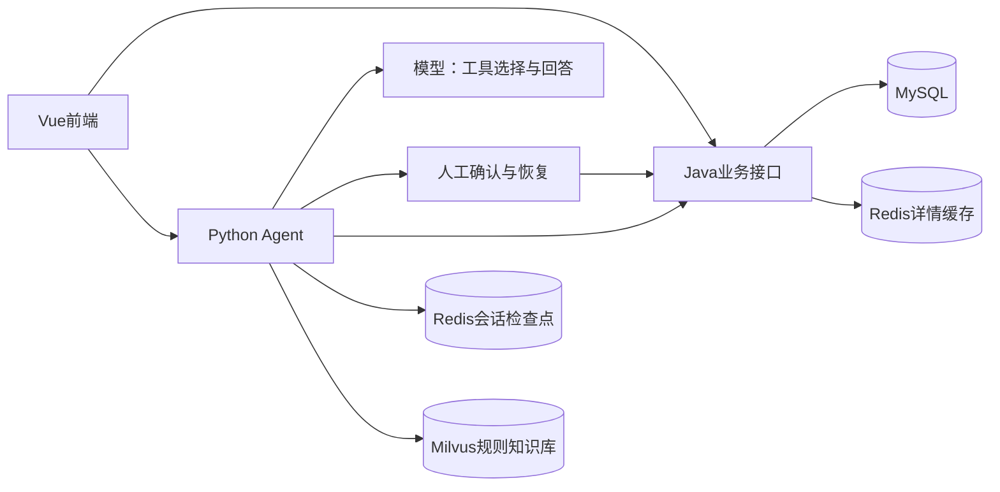

# 医联智诊｜医疗业务平台与患者端AI助手

面向患者、医生与管理员的医疗业务个人项目，整合Vue前端、Spring Boot后端与Python Agent，支持页面操作和自然语言查询，并在预约等写操作前由用户确认。

## 项目演示

以下截图来自仓库中的 Vue 前端。患者、医生和号源为合成数据，助手回复使用测试接口模拟，用于展示交互界面。

**预约前确认**：提交预约意图后，助手展示预约预览，提供「确认预约」和「再想想」。



**自然语言查号源**：在对话里询问医生的可预约时段，查看费用和余量。



**患者端首页**：集中展示医生查询、我的预约、排队签到和诊疗记录入口。



## 项目结构

```text
frontend/   Vue页面、业务交互、AI对话与SSE展示
backend/    Spring Boot医疗业务、鉴权、事务及MySQL访问
agent/      FastAPI、LangChain/LangGraph工具编排、Redis记忆与Milvus检索
docs/       架构与本地测试结果
```

## 实现能力

- 医生/号源/预约查询，模拟支付、取消退款、签到排队及诊疗信息查询。
- Agent调用Java API获取真实业务数据；JWT通过运行上下文传递，不作为模型工具参数。
- LangGraph人工确认、检查点恢复、Redis会话隔离与SSE流式回复。
- Markdown规则文档向量化、Milvus检索和来源提示；不是医疗诊断系统。
- Java端患者行锁、号源行锁、条件扣减及事务回滚；医生公开详情Redis旁路缓存。
- 预约列表联合索引与先分页后关联查询，迁移脚本位于backend/db/migrations。

## 调用关系



Java始终负责资源归属和业务状态校验，模型输出或用户确认不代替后端权限检查。

## 本地运行

环境：JDK17、Maven、MySQL8、Python3.12；前端Node版本须满足Vite依赖要求；Redis与Milvus需单独启动。模型、Embedding服务需自行配置，不包含API Key。

1. 手动审核并导入`backend/db/demo_init.sql`。它只创建全新`yilian_demo`，目标库存在时停止，不删除已有库。数据是人工合成演示数据。
2. 在启动Java的PowerShell中设置以下环境变量，替换为自己的数据库密码及足够长的随机JWT签名密钥，再运行：

```powershell
$env:DB_NAME='yilian_demo'
$env:DB_PASSWORD='<本机数据库密码>'
$env:JWT_SECRET='<自行生成至少32字节随机密钥>'
cd backend
mvn spring-boot:run
```

默认8080。可选开启公开详情缓存：设置`DOCTOR_CACHE_ENABLED=true`，并为环境指定唯一`DOCTOR_CACHE_PREFIX`。账号密码和JWT密钥只进入本机环境，不提交。

3. 启动Redis、Milvus，配置并启动Agent：

```powershell
cd agent
py -3.12 -m venv .venv
.\.venv\Scripts\Activate.ps1
python -m pip install -e ".[dev]"
Copy-Item .env.example .env
# 编辑.env：模型地址、模型名、Key、Redis/Milvus及Embedding维度
python -m app.scripts.ingest_knowledge
python -m uvicorn app.main:app --reload
```

Agent默认8000；RAG模型与Embedding维度必须使用服务商实际支持值，示例配置不是可直接使用的模型凭证。详细说明见`agent/README.md`。

4. 新终端启动前端：

```powershell
cd frontend
npm ci
npm run dev
```

开发代理默认Java8080、Agent8000，具体端口见frontend/vite.config.js。页面先登录演示患者账号，再使用AI助手。

演示账号：`demo_admin`、`demo_doctor`、`demo_patient`，仅演示密码`123456`，不得用于公网部署。

## 验证与技术记录

已在原开发环境完成下列指定场景，指标是本地测试而非生产SLA；详见[测试结果与边界](docs/测试结果与边界.md)。

| 验证 | 结果 |
| --- | --- |
| 100名患者竞争20个号源 | 修复后20成功、80余量不足，SQL核对一致 |
| 同患者100次重复提交 | 1成功、99冲突拒绝 |
| 真实数据库写入故障注入 | 库存和预约回滚 |
| 支付/取消竞争 | 最终20组无500，状态与库存组合合法 |
| Redis温缓存对照 | 本地10并发三轮P95中位数57.8→33.7ms |
| 预约SQL改写 | 10万合成记录中首页预约输入1000→10，SQL中位数3.11→0.28ms |

这些不是LLM准确率、RAG召回率或线上用户数据；本仓库不声明未经评测的模型指标。

## 边界与维护

- 本次发布为单体Java与独立Agent的整合，不包含Spring Cloud实验版。
- 支付是本地模拟；退款申请不等于真实渠道资金到账。
- Cache Aside存在短期旧读回填风险，不能当作预约库存依据。
- 公开资料、知识示例与合成账号供学习；不包含真实患者诊疗数据。
- 项目开发及测试脚本使用AI辅助，需结合源码、原始结果与人工审核理解实现。
- 尚未选择开源许可证；公开展示不代表授予任意再分发许可。
